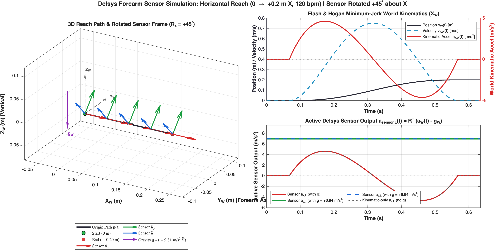

# Delsys Forearm Accelerometer 3D Kinematics Simulation Report

## 1. Executive Summary

This report documents the implementation and verification of a physiological 3D reaching simulation for active Delsys Trigno forearm accelerometers. Using the Flash & Hogan 5th-order minimum-jerk trajectory model ([gettragect.m](file:///Users/valeriyagritsenko/Documents/GitHub/Katie_ReachOrientationProcessing/gettragect.m)) and a multi-condition kinematic simulator ([simulate_delsys_sensor_kinematics.m](file:///Users/valeriyagritsenko/Documents/GitHub/Katie_ReachOrientationProcessing/simulate_delsys_sensor_kinematics.m)), the pipeline generates **216 self-contained `.mat` datasets** covering **8 reach trajectories** (horizontal and vertical, outbound and return, at 120 bpm and 80 bpm) across **27 unique 3D sensor orientations** (aligned, single-axis $\pm 45^\circ$, two-axis combinations, and three-axis combinations) with full gravitational acceleration modeling.

> [!NOTE]
> All MATLAB files passed static analysis (`checkcode -id`) with **0 warnings**, and all runtime assertions—$SO(3)$ orthonormality ($\det(R) = 1$, $R^T R = I$), pairwise uniqueness across all 27 rotation matrices, minimum-jerk boundary/peak-velocity/finite-difference checks, and Euclidean specific-force norm invariance—passed to machine precision (`< 1e-12`).

---

## 2. Code Implementation Architecture

### 2.1 Updated Minimum-Jerk Trajectory Generator: [gettragect.m](file:///Users/valeriyagritsenko/Documents/GitHub/Katie_ReachOrientationProcessing/gettragect.m)

The legacy [gettragect.m](file:///Users/valeriyagritsenko/Documents/GitHub/Katie_ReachOrientationProcessing/gettragect.m) relied on numerical integration (`cumsum`) and an external `splineKin` helper not present in this repository, and had sample-length mismatches when `bReturn == 1`. It has been updated to be **100% self-contained and analytically exact** while preserving its original 5-argument call signature (`[pos, vel, acc] = gettragect(nRate, tSim, sAngList, nROM, bReturn, nPad)`):

- **Exact Flash & Hogan (1985) Equations:** For normalized time $\tau = t / T_{\text{eff}} \in [0, 1]$ and excursion $\Delta x = x_f - x_0$:
  $$x(t) = x_0 + \Delta x \left(10\tau^3 - 15\tau^4 + 6\tau^5\right)$$
  $$v(t) = \frac{\Delta x}{T_{\text{eff}}} \cdot 30 \tau^2 (1 - \tau)^2, \qquad v_{\text{peak}} = \frac{15}{8} \frac{|\Delta x|}{T_{\text{eff}}}$$
  $$a(t) = \frac{\Delta x}{T_{\text{eff}}^2} \cdot 60 \tau (1 - \tau)(1 - 2\tau), \qquad |a_{\text{peak}}| = \frac{10}{\sqrt{3}} \frac{|\Delta x|}{T_{\text{eff}}^2}$$
- **Stationary Rest Padding (`nPad = 10` default):** Because $v(0) = v(T) = 0$ and $a(0) = a(T) = 0$, appending 10 stationary samples (~67.5 ms at `148.15 Hz`) at the start and end (and between outbound/return phases when `bReturn == 1`) yields $C^2$-continuous signals with clean static gravity baselines before onset and after offset.
- **Discrete-Grid Consistency:** The active movement spans $N_{\text{move}} = \text{round}(f_s \cdot t_{\text{sim}})$ intervals with $T_{\text{eff}} = N_{\text{move}} / f_s$, ensuring exact agreement between discrete position, analytical velocity, and analytical acceleration.

### 2.2 Multi-Condition Sensor Simulator: [simulate_delsys_sensor_kinematics.m](file:///Users/valeriyagritsenko/Documents/GitHub/Katie_ReachOrientationProcessing/simulate_delsys_sensor_kinematics.m)

Callable with default settings via `manifestTable = simulate_delsys_sensor_kinematics()` (or custom `(outputDir, nRate, makePlot)`), the function implements:

1. **World Coordinate Frame ($W$) & Gravity Vector:**
   - $+X_W$: Horizontal reach axis ($0 \leftrightarrow +0.2\text{ m}$).
   - $+Y_W$: Nominal forearm longitudinal axis (aligned with the Delsys sensor $+Y$ axis when unrotated).
   - $+Z_W$: Vertically upward ($0 \leftrightarrow +0.2\text{ m}$).
   - Gravitational acceleration points downward along $-Z_W$:
     $$\mathbf{g}_W = \begin{bmatrix} 0 \\ 0 \\ -9.81 \end{bmatrix}\text{ m/s}^2$$
   - Sampling frequency defaults to `nRate = 148.15 Hz` (matching the Delsys Trigno accelerometer rate in `README.md`).

2. **Active Accelerometer Measurement Model (Specific Force):**
   - Active MEMS accelerometers (Delsys Trigno) measure **specific force** (proper acceleration), so a stationary face-up sensor (`+Z_L` pointing along `+Z_W`) reads $+1\,g$ ($+9.81\text{ m/s}^2$) on its $Z$ channel:
     $$\mathbf{a}_{\text{sensor},W}(t) = \mathbf{a}_{\text{kin},W}(t) - \mathbf{g}_W = \mathbf{a}_{\text{kin},W}(t) + \begin{bmatrix} 0 \\ 0 \\ +9.81 \end{bmatrix}$$
     $$\mathbf{a}_{\text{sensor},L}(t) = R^T \mathbf{a}_{\text{sensor},W}(t)$$
   - Both gravity-included active sensor signals (`acc_local_sensor` in $\text{m/s}^2$, `acc_local_sensor_g` in $g$) and kinematic-only signals (`acc_local_kinematic`) are saved in every `.mat` file.

3. **Ordered 27-Orientation Rotation Sweep ($SO(3)$):**
   - Rotation matrices are constructed via `buildRotationZYX` using standard extrinsic $X\text{-}Y\text{-}Z$ (intrinsic $Z\text{-}Y\text{-}X$) Euler composition:
     $$R = R_z(\theta_z)\, R_y(\theta_y)\, R_x(\theta_x)$$
     whose columns are the rotated local unit basis vectors $[\hat{u}_x, \hat{u}_y, \hat{u}_z]$ expressed in $W$.
   - The sweep progresses cleanly through all 27 unique orientations in $\{-45^\circ, 0^\circ, +45^\circ\}^3$:
     - **Tier 0 — Aligned (1):** $(0, 0, 0)$
     - **Tier 1 — Single-axis $\pm 45^\circ$ (6):** $+45X, -45X, +45Y, -45Y, +45Z, -45Z$
     - **Tier 2 — Two-axis $\pm 45^\circ$ combinations (12):** $X\&Y$ (4), $X\&Z$ (4), $Y\&Z$ (4)
     - **Tier 3 — Three-axis $\pm 45^\circ$ combinations (8):** $X\&Y\&Z$ (8)

4. **Built-in Verification Assertions:**
   - Every orientation is asserted to satisfy $|\det(R) - 1| < 10^{-12}$, $\|R^T R - I\|_F < 10^{-12}$, unit basis vector norms, right-handedness ($\hat{u}_x \times \hat{u}_y = \hat{u}_z$), and pairwise uniqueness across all 27 matrices.
   - Every trajectory is asserted to match exact start/end coordinates, zero boundary velocity/acceleration, theoretical Flash & Hogan peak velocity, and 2nd-order finite-difference acceleration consistency.
   - Every simulation run is asserted to preserve Euclidean acceleration magnitude $\|\mathbf{a}_{\text{sensor},L}(t)\|_2 = \|\mathbf{a}_{\text{sensor},W}(t)\|_2$ within $10^{-12}$.

---

## 3. Example Visualization & Physical Verification

Below is the generated verification figure for **Trajectory 1** (Horizontal reach from origin $0 \to +0.2\text{ m}$ along $X_W$ at 120 bpm, $T = 0.50\text{ s}$) with the sensor rotated **$+45^\circ$ about $X$** (`H_OrigToPos0p2X_120bpm_Rxp45_Ry0_Rz0.mat`):



- **Left (3D Path & Sensor Triads):** Five evenly spaced triads along $X_W \in [0, 0.20]\text{ m}$ show $\hat{u}_x$ aligned with $+X_W$, while $\hat{u}_y$ and $\hat{u}_z$ are tilted $+45^\circ$ counter-clockwise about $+X_W$ relative to the dashed World frame $(X_W, Y_W, Z_W)$, with gravity $\mathbf{g}_W$ pointing down along $-Z_W$.
- **Top-Right (World Minimum-Jerk Kinematics):** Smooth sigmoidal displacement $0 \to 0.20\text{ m}$, symmetric bell-shaped velocity peaking at $0.751\text{ m/s}$, and biphasic acceleration peaking at $\pm 4.626\text{ m/s}^2$, bracketed by zero-velocity stationary pads.
- **Bottom-Right (Active Sensor Output in Local Frame $L$):**
  - $a_{x,L}(t)$ equals the pure biphasic reach acceleration ($\pm 4.626\text{ m/s}^2$) because $\hat{u}_x \perp \mathbf{g}_W$.
  - $a_{y,L}(t)$ and $a_{z,L}(t)$ both remain constant at $+9.81 \cdot \frac{\sqrt{2}}{2} = +6.9367\text{ m/s}^2$ ($+0.7071\,g$), reflecting equal projection of the upward specific-force gravity component onto the $+45^\circ$-rotated $Y_L$ and $Z_L$ axes.

---

## 4. `.mat` File Schema

Each `.mat` file in [simulated_sensor_outputs/](file:///Users/valeriyagritsenko/Documents/GitHub/Katie_ReachOrientationProcessing/simulated_sensor_outputs) stores top-level variables directly loadable via `S = load(filename)`:

| Variable | Size / Type | Units / Description |
| :--- | :--- | :--- |
| `condition` | `1×1 struct` | Metadata (`fileName`, `trajectoryId`, `trajectoryName`, `plane`, `direction`, `bpm`, `tSimNominal_s`, `tMoveActual_s`, `nRate_Hz`, `nPadSamples`, `rotationGroup`, `rot_deg`, `eulerOrder`, `gravityModel`) |
| `tTime` | `N×1 double` | Time vector (s) at `148.15 Hz` (`N = 95` for 120 bpm, `N = 132` for 80 bpm) |
| `R`, `basis_L` | `3×3 double` | Orthonormal rotation matrix $R \in SO(3)$ (`columns = [u_x, u_y, u_z]` in $W$) |
| `g_world` | `3×1 double` | World gravity vector `[0; 0; -9.81]` ($\text{m/s}^2$) |
| `pos_world` | `N×3 double` | Origin position $[x_W, y_W, z_W]$ (m) |
| `vel_world` | `N×3 double` | Origin velocity $[v_{x,W}, v_{y,W}, v_{z,W}]$ ($\text{m/s}$) |
| `acc_world_kinematic` | `N×3 double` | Kinematic linear acceleration $\mathbf{a}_W(t)$ ($\text{m/s}^2$) |
| `acc_world_sensor` | `N×3 double` | Specific force in World frame $\mathbf{a}_W(t) - \mathbf{g}_W$ ($\text{m/s}^2$) |
| `acc_local_kinematic` | `N×3 double` | Kinematic acceleration in Local frame $R^T \mathbf{a}_W(t)$ ($\text{m/s}^2$) |
| `acc_local_sensor` | `N×3 double` | **Active Delsys sensor output** $R^T (\mathbf{a}_W(t) - \mathbf{g}_W)$ ($\text{m/s}^2$) |
| `acc_local_sensor_g` | `N×3 double` | Active Delsys sensor output normalized by $9.81\text{ m/s}^2$ ($g$) |

---

## 5. Summary of All Output Files

### 5.1 Primary Scripts, Figures & Master Manifest

| Output File | Description |
| :--- | :--- |
| [gettragect.m](file:///Users/valeriyagritsenko/Documents/GitHub/Katie_ReachOrientationProcessing/gettragect.m) | Updated Flash & Hogan minimum-jerk trajectory generator |
| [simulate_delsys_sensor_kinematics.m](file:///Users/valeriyagritsenko/Documents/GitHub/Katie_ReachOrientationProcessing/simulate_delsys_sensor_kinematics.m) | Main 8-trajectory × 27-orientation active sensor simulator |
| [example_H_OrigToPos0p2X_Rxp45.png](file:///Users/valeriyagritsenko/Documents/GitHub/Katie_ReachOrientationProcessing/example_H_OrigToPos0p2X_Rxp45.png) | 3-panel verification plot (Horizontal $0 \to +0.2X$, 120 bpm, $R_x = +45^\circ$) |
| [simulation_manifest.csv](file:///Users/valeriyagritsenko/Documents/GitHub/Katie_ReachOrientationProcessing/simulated_sensor_outputs/simulation_manifest.csv) | Master CSV index of all 216 `.mat` files with static & peak sensor metrics |
| [delsys_simulation_report.md](file:///Users/valeriyagritsenko/Documents/GitHub/Katie_ReachOrientationProcessing/delsys_simulation_report.md) | Repository copy of this report |

### 5.2 Naming Convention for All 216 `.mat` Files

All 216 `.mat` files live inside [simulated_sensor_outputs/](file:///Users/valeriyagritsenko/Documents/GitHub/Katie_ReachOrientationProcessing/simulated_sensor_outputs) and follow the deterministic naming scheme:

```text
<TrajectoryPrefix>_Rx<angle>_Ry<angle>_Rz<angle>.mat
```
where positive angles use `p45`, negative angles use `m45`, and zero rotation uses `0`.

### 5.3 The 8 Trajectory Prefixes

| ID | Trajectory Prefix | Plane | Path (m) | Pace | Duration | Samples ($N$) | Peak Speed (m/s) | Peak Kinematic Accel ($\text{m/s}^2$) |
| :-: | :--- | :--- | :--- | :-: | :-: | :-: | :-: | :-: |
| 1 | `H_OrigToPos0p2X_120bpm` | Horizontal | `[0,0,0] -> [+0.2,0,0]` | 120 bpm | `60/120 = 0.50 s` | 95 | 0.751 | 4.626 |
| 2 | `H_OrigToPos0p2X_80bpm` | Horizontal | `[0,0,0] -> [+0.2,0,0]` | 80 bpm | `60/80 = 0.75 s` | 132 | 0.500 | 2.056 |
| 3 | `H_Pos0p2XToOrig_120bpm` | Horizontal | `[+0.2,0,0] -> [0,0,0]` | 120 bpm | `60/120 = 0.50 s` | 95 | 0.751 | 4.626 |
| 4 | `H_Pos0p2XToOrig_80bpm` | Horizontal | `[+0.2,0,0] -> [0,0,0]` | 80 bpm | `60/80 = 0.75 s` | 132 | 0.500 | 2.056 |
| 5 | `V_OrigToPos0p2Z_120bpm` | Vertical | `[0,0,0] -> [0,0,+0.2]` | 120 bpm | `60/120 = 0.50 s` | 95 | 0.751 | 4.626 |
| 6 | `V_OrigToPos0p2Z_80bpm` | Vertical | `[0,0,0] -> [0,0,+0.2]` | 80 bpm | `60/80 = 0.75 s` | 132 | 0.500 | 2.056 |
| 7 | `V_Pos0p2ZToOrig_120bpm` | Vertical | `[0,0,+0.2] -> [0,0,0]` | 120 bpm | `60/120 = 0.50 s` | 95 | 0.751 | 4.626 |
| 8 | `V_Pos0p2ZToOrig_80bpm` | Vertical | `[0,0,+0.2] -> [0,0,0]` | 80 bpm | `60/80 = 0.75 s` | 132 | 0.500 | 2.056 |

### 5.4 The 27 Orientation Suffixes & Static Gravity Baselines

| # | Tier | Orientation Suffix | $(R_x, R_y, R_z)$ deg | Static $a_{x,L}$ ($\text{m/s}^2$) | Static $a_{y,L}$ ($\text{m/s}^2$) | Static $a_{z,L}$ ($\text{m/s}^2$) |
| :-: | :--- | :--- | :-: | :-: | :-: | :-: |
| 1 | Aligned | `Rx0_Ry0_Rz0` | `(0, 0, 0)` | `0.000` | `0.000` | `+9.810` |
| 2 | SingleAxis | `Rxp45_Ry0_Rz0` | `(+45, 0, 0)` | `0.000` | `+6.937` | `+6.937` |
| 3 | SingleAxis | `Rxm45_Ry0_Rz0` | `(-45, 0, 0)` | `0.000` | `-6.937` | `+6.937` |
| 4 | SingleAxis | `Rx0_Ryp45_Rz0` | `(0, +45, 0)` | `-6.937` | `0.000` | `+6.937` |
| 5 | SingleAxis | `Rx0_Rym45_Rz0` | `(0, -45, 0)` | `+6.937` | `0.000` | `+6.937` |
| 6 | SingleAxis | `Rx0_Ry0_Rzp45` | `(0, 0, +45)` | `0.000` | `0.000` | `+9.810` |
| 7 | SingleAxis | `Rx0_Ry0_Rzm45` | `(0, 0, -45)` | `0.000` | `0.000` | `+9.810` |
| 8 | TwoAxis (X&Y) | `Rxp45_Ryp45_Rz0` | `(+45, +45, 0)` | `-6.937` | `+4.905` | `+4.905` |
| 9 | TwoAxis (X&Y) | `Rxp45_Rym45_Rz0` | `(+45, -45, 0)` | `+6.937` | `+4.905` | `+4.905` |
| 10 | TwoAxis (X&Y) | `Rxm45_Ryp45_Rz0` | `(-45, +45, 0)` | `-6.937` | `-4.905` | `+4.905` |
| 11 | TwoAxis (X&Y) | `Rxm45_Rym45_Rz0` | `(-45, -45, 0)` | `+6.937` | `-4.905` | `+4.905` |
| 12 | TwoAxis (X&Z) | `Rxp45_Ry0_Rzp45` | `(+45, 0, +45)` | `0.000` | `+6.937` | `+6.937` |
| 13 | TwoAxis (X&Z) | `Rxp45_Ry0_Rzm45` | `(+45, 0, -45)` | `0.000` | `+6.937` | `+6.937` |
| 14 | TwoAxis (X&Z) | `Rxm45_Ry0_Rzp45` | `(-45, 0, +45)` | `0.000` | `-6.937` | `+6.937` |
| 15 | TwoAxis (X&Z) | `Rxm45_Ry0_Rzm45` | `(-45, 0, -45)` | `0.000` | `-6.937` | `+6.937` |
| 16 | TwoAxis (Y&Z) | `Rx0_Ryp45_Rzp45` | `(0, +45, +45)` | `-6.937` | `0.000` | `+6.937` |
| 17 | TwoAxis (Y&Z) | `Rx0_Ryp45_Rzm45` | `(0, +45, -45)` | `-6.937` | `0.000` | `+6.937` |
| 18 | TwoAxis (Y&Z) | `Rx0_Rym45_Rzp45` | `(0, -45, +45)` | `+6.937` | `0.000` | `+6.937` |
| 19 | TwoAxis (Y&Z) | `Rx0_Rym45_Rzm45` | `(0, -45, -45)` | `+6.937` | `0.000` | `+6.937` |
| 20 | ThreeAxis | `Rxp45_Ryp45_Rzp45` | `(+45, +45, +45)` | `-6.937` | `+4.905` | `+4.905` |
| 21 | ThreeAxis | `Rxp45_Ryp45_Rzm45` | `(+45, +45, -45)` | `-6.937` | `+4.905` | `+4.905` |
| 22 | ThreeAxis | `Rxp45_Rym45_Rzp45` | `(+45, -45, +45)` | `+6.937` | `+4.905` | `+4.905` |
| 23 | ThreeAxis | `Rxp45_Rym45_Rzm45` | `(+45, -45, -45)` | `+6.937` | `+4.905` | `+4.905` |
| 24 | ThreeAxis | `Rxm45_Ryp45_Rzp45` | `(-45, +45, +45)` | `-6.937` | `-4.905` | `+4.905` |
| 25 | ThreeAxis | `Rxm45_Ryp45_Rzm45` | `(-45, +45, -45)` | `-6.937` | `-4.905` | `+4.905` |
| 26 | ThreeAxis | `Rxm45_Rym45_Rzp45` | `(-45, -45, +45)` | `+6.937` | `-4.905` | `+4.905` |
| 27 | ThreeAxis | `Rxm45_Rym45_Rzm45` | `(-45, -45, -45)` | `+6.937` | `-4.905` | `+4.905` |

### 5.5 Complete Catalog of All 216 Generated `.mat` Files

Every trajectory prefix below pairs with all 27 orientation suffixes above (`8 × 27 = 216` files in `simulated_sensor_outputs/`):

<details>
<summary><strong>1. Horizontal: Origin → +0.2X, 120 bpm (27 files)</strong></summary>

- `H_OrigToPos0p2X_120bpm_Rx0_Ry0_Rz0.mat`
- `H_OrigToPos0p2X_120bpm_Rxp45_Ry0_Rz0.mat` *(example plot condition)*
- `H_OrigToPos0p2X_120bpm_Rxm45_Ry0_Rz0.mat`
- `H_OrigToPos0p2X_120bpm_Rx0_Ryp45_Rz0.mat`
- `H_OrigToPos0p2X_120bpm_Rx0_Rym45_Rz0.mat`
- `H_OrigToPos0p2X_120bpm_Rx0_Ry0_Rzp45.mat`
- `H_OrigToPos0p2X_120bpm_Rx0_Ry0_Rzm45.mat`
- `H_OrigToPos0p2X_120bpm_Rxp45_Ryp45_Rz0.mat`
- `H_OrigToPos0p2X_120bpm_Rxp45_Rym45_Rz0.mat`
- `H_OrigToPos0p2X_120bpm_Rxm45_Ryp45_Rz0.mat`
- `H_OrigToPos0p2X_120bpm_Rxm45_Rym45_Rz0.mat`
- `H_OrigToPos0p2X_120bpm_Rxp45_Ry0_Rzp45.mat`
- `H_OrigToPos0p2X_120bpm_Rxp45_Ry0_Rzm45.mat`
- `H_OrigToPos0p2X_120bpm_Rxm45_Ry0_Rzp45.mat`
- `H_OrigToPos0p2X_120bpm_Rxm45_Ry0_Rzm45.mat`
- `H_OrigToPos0p2X_120bpm_Rx0_Ryp45_Rzp45.mat`
- `H_OrigToPos0p2X_120bpm_Rx0_Ryp45_Rzm45.mat`
- `H_OrigToPos0p2X_120bpm_Rx0_Rym45_Rzp45.mat`
- `H_OrigToPos0p2X_120bpm_Rx0_Rym45_Rzm45.mat`
- `H_OrigToPos0p2X_120bpm_Rxp45_Ryp45_Rzp45.mat`
- `H_OrigToPos0p2X_120bpm_Rxp45_Ryp45_Rzm45.mat`
- `H_OrigToPos0p2X_120bpm_Rxp45_Rym45_Rzp45.mat`
- `H_OrigToPos0p2X_120bpm_Rxp45_Rym45_Rzm45.mat`
- `H_OrigToPos0p2X_120bpm_Rxm45_Ryp45_Rzp45.mat`
- `H_OrigToPos0p2X_120bpm_Rxm45_Ryp45_Rzm45.mat`
- `H_OrigToPos0p2X_120bpm_Rxm45_Rym45_Rzp45.mat`
- `H_OrigToPos0p2X_120bpm_Rxm45_Rym45_Rzm45.mat`

</details>

<details>
<summary><strong>2. Horizontal: Origin → +0.2X, 80 bpm (27 files)</strong></summary>

- `H_OrigToPos0p2X_80bpm_Rx0_Ry0_Rz0.mat`
- `H_OrigToPos0p2X_80bpm_Rxp45_Ry0_Rz0.mat`
- `H_OrigToPos0p2X_80bpm_Rxm45_Ry0_Rz0.mat`
- `H_OrigToPos0p2X_80bpm_Rx0_Ryp45_Rz0.mat`
- `H_OrigToPos0p2X_80bpm_Rx0_Rym45_Rz0.mat`
- `H_OrigToPos0p2X_80bpm_Rx0_Ry0_Rzp45.mat`
- `H_OrigToPos0p2X_80bpm_Rx0_Ry0_Rzm45.mat`
- `H_OrigToPos0p2X_80bpm_Rxp45_Ryp45_Rz0.mat`
- `H_OrigToPos0p2X_80bpm_Rxp45_Rym45_Rz0.mat`
- `H_OrigToPos0p2X_80bpm_Rxm45_Ryp45_Rz0.mat`
- `H_OrigToPos0p2X_80bpm_Rxm45_Rym45_Rz0.mat`
- `H_OrigToPos0p2X_80bpm_Rxp45_Ry0_Rzp45.mat`
- `H_OrigToPos0p2X_80bpm_Rxp45_Ry0_Rzm45.mat`
- `H_OrigToPos0p2X_80bpm_Rxm45_Ry0_Rzp45.mat`
- `H_OrigToPos0p2X_80bpm_Rxm45_Ry0_Rzm45.mat`
- `H_OrigToPos0p2X_80bpm_Rx0_Ryp45_Rzp45.mat`
- `H_OrigToPos0p2X_80bpm_Rx0_Ryp45_Rzm45.mat`
- `H_OrigToPos0p2X_80bpm_Rx0_Rym45_Rzp45.mat`
- `H_OrigToPos0p2X_80bpm_Rx0_Rym45_Rzm45.mat`
- `H_OrigToPos0p2X_80bpm_Rxp45_Ryp45_Rzp45.mat`
- `H_OrigToPos0p2X_80bpm_Rxp45_Ryp45_Rzm45.mat`
- `H_OrigToPos0p2X_80bpm_Rxp45_Rym45_Rzp45.mat`
- `H_OrigToPos0p2X_80bpm_Rxp45_Rym45_Rzm45.mat`
- `H_OrigToPos0p2X_80bpm_Rxm45_Ryp45_Rzp45.mat`
- `H_OrigToPos0p2X_80bpm_Rxm45_Ryp45_Rzm45.mat`
- `H_OrigToPos0p2X_80bpm_Rxm45_Rym45_Rzp45.mat`
- `H_OrigToPos0p2X_80bpm_Rxm45_Rym45_Rzm45.mat`

</details>

<details>
<summary><strong>3. Horizontal: +0.2X → Origin, 120 bpm (27 files)</strong></summary>

- `H_Pos0p2XToOrig_120bpm_Rx0_Ry0_Rz0.mat`
- `H_Pos0p2XToOrig_120bpm_Rxp45_Ry0_Rz0.mat`
- `H_Pos0p2XToOrig_120bpm_Rxm45_Ry0_Rz0.mat`
- `H_Pos0p2XToOrig_120bpm_Rx0_Ryp45_Rz0.mat`
- `H_Pos0p2XToOrig_120bpm_Rx0_Rym45_Rz0.mat`
- `H_Pos0p2XToOrig_120bpm_Rx0_Ry0_Rzp45.mat`
- `H_Pos0p2XToOrig_120bpm_Rx0_Ry0_Rzm45.mat`
- `H_Pos0p2XToOrig_120bpm_Rxp45_Ryp45_Rz0.mat`
- `H_Pos0p2XToOrig_120bpm_Rxp45_Rym45_Rz0.mat`
- `H_Pos0p2XToOrig_120bpm_Rxm45_Ryp45_Rz0.mat`
- `H_Pos0p2XToOrig_120bpm_Rxm45_Rym45_Rz0.mat`
- `H_Pos0p2XToOrig_120bpm_Rxp45_Ry0_Rzp45.mat`
- `H_Pos0p2XToOrig_120bpm_Rxp45_Ry0_Rzm45.mat`
- `H_Pos0p2XToOrig_120bpm_Rxm45_Ry0_Rzp45.mat`
- `H_Pos0p2XToOrig_120bpm_Rxm45_Ry0_Rzm45.mat`
- `H_Pos0p2XToOrig_120bpm_Rx0_Ryp45_Rzp45.mat`
- `H_Pos0p2XToOrig_120bpm_Rx0_Ryp45_Rzm45.mat`
- `H_Pos0p2XToOrig_120bpm_Rx0_Rym45_Rzp45.mat`
- `H_Pos0p2XToOrig_120bpm_Rx0_Rym45_Rzm45.mat`
- `H_Pos0p2XToOrig_120bpm_Rxp45_Ryp45_Rzp45.mat`
- `H_Pos0p2XToOrig_120bpm_Rxp45_Ryp45_Rzm45.mat`
- `H_Pos0p2XToOrig_120bpm_Rxp45_Rym45_Rzp45.mat`
- `H_Pos0p2XToOrig_120bpm_Rxp45_Rym45_Rzm45.mat`
- `H_Pos0p2XToOrig_120bpm_Rxm45_Ryp45_Rzp45.mat`
- `H_Pos0p2XToOrig_120bpm_Rxm45_Ryp45_Rzm45.mat`
- `H_Pos0p2XToOrig_120bpm_Rxm45_Rym45_Rzp45.mat`
- `H_Pos0p2XToOrig_120bpm_Rxm45_Rym45_Rzm45.mat`

</details>

<details>
<summary><strong>4. Horizontal: +0.2X → Origin, 80 bpm (27 files)</strong></summary>

- `H_Pos0p2XToOrig_80bpm_Rx0_Ry0_Rz0.mat`
- `H_Pos0p2XToOrig_80bpm_Rxp45_Ry0_Rz0.mat`
- `H_Pos0p2XToOrig_80bpm_Rxm45_Ry0_Rz0.mat`
- `H_Pos0p2XToOrig_80bpm_Rx0_Ryp45_Rz0.mat`
- `H_Pos0p2XToOrig_80bpm_Rx0_Rym45_Rz0.mat`
- `H_Pos0p2XToOrig_80bpm_Rx0_Ry0_Rzp45.mat`
- `H_Pos0p2XToOrig_80bpm_Rx0_Ry0_Rzm45.mat`
- `H_Pos0p2XToOrig_80bpm_Rxp45_Ryp45_Rz0.mat`
- `H_Pos0p2XToOrig_80bpm_Rxp45_Rym45_Rz0.mat`
- `H_Pos0p2XToOrig_80bpm_Rxm45_Ryp45_Rz0.mat`
- `H_Pos0p2XToOrig_80bpm_Rxm45_Rym45_Rz0.mat`
- `H_Pos0p2XToOrig_80bpm_Rxp45_Ry0_Rzp45.mat`
- `H_Pos0p2XToOrig_80bpm_Rxp45_Ry0_Rzm45.mat`
- `H_Pos0p2XToOrig_80bpm_Rxm45_Ry0_Rzp45.mat`
- `H_Pos0p2XToOrig_80bpm_Rxm45_Ry0_Rzm45.mat`
- `H_Pos0p2XToOrig_80bpm_Rx0_Ryp45_Rzp45.mat`
- `H_Pos0p2XToOrig_80bpm_Rx0_Ryp45_Rzm45.mat`
- `H_Pos0p2XToOrig_80bpm_Rx0_Rym45_Rzp45.mat`
- `H_Pos0p2XToOrig_80bpm_Rx0_Rym45_Rzm45.mat`
- `H_Pos0p2XToOrig_80bpm_Rxp45_Ryp45_Rzp45.mat`
- `H_Pos0p2XToOrig_80bpm_Rxp45_Ryp45_Rzm45.mat`
- `H_Pos0p2XToOrig_80bpm_Rxp45_Rym45_Rzp45.mat`
- `H_Pos0p2XToOrig_80bpm_Rxp45_Rym45_Rzm45.mat`
- `H_Pos0p2XToOrig_80bpm_Rxm45_Ryp45_Rzp45.mat`
- `H_Pos0p2XToOrig_80bpm_Rxm45_Ryp45_Rzm45.mat`
- `H_Pos0p2XToOrig_80bpm_Rxm45_Rym45_Rzp45.mat`
- `H_Pos0p2XToOrig_80bpm_Rxm45_Rym45_Rzm45.mat`

</details>

<details>
<summary><strong>5. Vertical: Origin → +0.2Z, 120 bpm (27 files)</strong></summary>

- `V_OrigToPos0p2Z_120bpm_Rx0_Ry0_Rz0.mat`
- `V_OrigToPos0p2Z_120bpm_Rxp45_Ry0_Rz0.mat`
- `V_OrigToPos0p2Z_120bpm_Rxm45_Ry0_Rz0.mat`
- `V_OrigToPos0p2Z_120bpm_Rx0_Ryp45_Rz0.mat`
- `V_OrigToPos0p2Z_120bpm_Rx0_Rym45_Rz0.mat`
- `V_OrigToPos0p2Z_120bpm_Rx0_Ry0_Rzp45.mat`
- `V_OrigToPos0p2Z_120bpm_Rx0_Ry0_Rzm45.mat`
- `V_OrigToPos0p2Z_120bpm_Rxp45_Ryp45_Rz0.mat`
- `V_OrigToPos0p2Z_120bpm_Rxp45_Rym45_Rz0.mat`
- `V_OrigToPos0p2Z_120bpm_Rxm45_Ryp45_Rz0.mat`
- `V_OrigToPos0p2Z_120bpm_Rxm45_Rym45_Rz0.mat`
- `V_OrigToPos0p2Z_120bpm_Rxp45_Ry0_Rzp45.mat`
- `V_OrigToPos0p2Z_120bpm_Rxp45_Ry0_Rzm45.mat`
- `V_OrigToPos0p2Z_120bpm_Rxm45_Ry0_Rzp45.mat`
- `V_OrigToPos0p2Z_120bpm_Rxm45_Ry0_Rzm45.mat`
- `V_OrigToPos0p2Z_120bpm_Rx0_Ryp45_Rzp45.mat`
- `V_OrigToPos0p2Z_120bpm_Rx0_Ryp45_Rzm45.mat`
- `V_OrigToPos0p2Z_120bpm_Rx0_Rym45_Rzp45.mat`
- `V_OrigToPos0p2Z_120bpm_Rx0_Rym45_Rzm45.mat`
- `V_OrigToPos0p2Z_120bpm_Rxp45_Ryp45_Rzp45.mat`
- `V_OrigToPos0p2Z_120bpm_Rxp45_Ryp45_Rzm45.mat`
- `V_OrigToPos0p2Z_120bpm_Rxp45_Rym45_Rzp45.mat`
- `V_OrigToPos0p2Z_120bpm_Rxp45_Rym45_Rzm45.mat`
- `V_OrigToPos0p2Z_120bpm_Rxm45_Ryp45_Rzp45.mat`
- `V_OrigToPos0p2Z_120bpm_Rxm45_Ryp45_Rzm45.mat`
- `V_OrigToPos0p2Z_120bpm_Rxm45_Rym45_Rzp45.mat`
- `V_OrigToPos0p2Z_120bpm_Rxm45_Rym45_Rzm45.mat`

</details>

<details>
<summary><strong>6. Vertical: Origin → +0.2Z, 80 bpm (27 files)</strong></summary>

- `V_OrigToPos0p2Z_80bpm_Rx0_Ry0_Rz0.mat`
- `V_OrigToPos0p2Z_80bpm_Rxp45_Ry0_Rz0.mat`
- `V_OrigToPos0p2Z_80bpm_Rxm45_Ry0_Rz0.mat`
- `V_OrigToPos0p2Z_80bpm_Rx0_Ryp45_Rz0.mat`
- `V_OrigToPos0p2Z_80bpm_Rx0_Rym45_Rz0.mat`
- `V_OrigToPos0p2Z_80bpm_Rx0_Ry0_Rzp45.mat`
- `V_OrigToPos0p2Z_80bpm_Rx0_Ry0_Rzm45.mat`
- `V_OrigToPos0p2Z_80bpm_Rxp45_Ryp45_Rz0.mat`
- `V_OrigToPos0p2Z_80bpm_Rxp45_Rym45_Rz0.mat`
- `V_OrigToPos0p2Z_80bpm_Rxm45_Ryp45_Rz0.mat`
- `V_OrigToPos0p2Z_80bpm_Rxm45_Rym45_Rz0.mat`
- `V_OrigToPos0p2Z_80bpm_Rxp45_Ry0_Rzp45.mat`
- `V_OrigToPos0p2Z_80bpm_Rxp45_Ry0_Rzm45.mat`
- `V_OrigToPos0p2Z_80bpm_Rxm45_Ry0_Rzp45.mat`
- `V_OrigToPos0p2Z_80bpm_Rxm45_Ry0_Rzm45.mat`
- `V_OrigToPos0p2Z_80bpm_Rx0_Ryp45_Rzp45.mat`
- `V_OrigToPos0p2Z_80bpm_Rx0_Ryp45_Rzm45.mat`
- `V_OrigToPos0p2Z_80bpm_Rx0_Rym45_Rzp45.mat`
- `V_OrigToPos0p2Z_80bpm_Rx0_Rym45_Rzm45.mat`
- `V_OrigToPos0p2Z_80bpm_Rxp45_Ryp45_Rzp45.mat`
- `V_OrigToPos0p2Z_80bpm_Rxp45_Ryp45_Rzm45.mat`
- `V_OrigToPos0p2Z_80bpm_Rxp45_Rym45_Rzp45.mat`
- `V_OrigToPos0p2Z_80bpm_Rxp45_Rym45_Rzm45.mat`
- `V_OrigToPos0p2Z_80bpm_Rxm45_Ryp45_Rzp45.mat`
- `V_OrigToPos0p2Z_80bpm_Rxm45_Ryp45_Rzm45.mat`
- `V_OrigToPos0p2Z_80bpm_Rxm45_Rym45_Rzp45.mat`
- `V_OrigToPos0p2Z_80bpm_Rxm45_Rym45_Rzm45.mat`

</details>

<details>
<summary><strong>7. Vertical: +0.2Z → Origin, 120 bpm (27 files)</strong></summary>

- `V_Pos0p2ZToOrig_120bpm_Rx0_Ry0_Rz0.mat`
- `V_Pos0p2ZToOrig_120bpm_Rxp45_Ry0_Rz0.mat`
- `V_Pos0p2ZToOrig_120bpm_Rxm45_Ry0_Rz0.mat`
- `V_Pos0p2ZToOrig_120bpm_Rx0_Ryp45_Rz0.mat`
- `V_Pos0p2ZToOrig_120bpm_Rx0_Rym45_Rz0.mat`
- `V_Pos0p2ZToOrig_120bpm_Rx0_Ry0_Rzp45.mat`
- `V_Pos0p2ZToOrig_120bpm_Rx0_Ry0_Rzm45.mat`
- `V_Pos0p2ZToOrig_120bpm_Rxp45_Ryp45_Rz0.mat`
- `V_Pos0p2ZToOrig_120bpm_Rxp45_Rym45_Rz0.mat`
- `V_Pos0p2ZToOrig_120bpm_Rxm45_Ryp45_Rz0.mat`
- `V_Pos0p2ZToOrig_120bpm_Rxm45_Rym45_Rz0.mat`
- `V_Pos0p2ZToOrig_120bpm_Rxp45_Ry0_Rzp45.mat`
- `V_Pos0p2ZToOrig_120bpm_Rxp45_Ry0_Rzm45.mat`
- `V_Pos0p2ZToOrig_120bpm_Rxm45_Ry0_Rzp45.mat`
- `V_Pos0p2ZToOrig_120bpm_Rxm45_Ry0_Rzm45.mat`
- `V_Pos0p2ZToOrig_120bpm_Rx0_Ryp45_Rzp45.mat`
- `V_Pos0p2ZToOrig_120bpm_Rx0_Ryp45_Rzm45.mat`
- `V_Pos0p2ZToOrig_120bpm_Rx0_Rym45_Rzp45.mat`
- `V_Pos0p2ZToOrig_120bpm_Rx0_Rym45_Rzm45.mat`
- `V_Pos0p2ZToOrig_120bpm_Rxp45_Ryp45_Rzp45.mat`
- `V_Pos0p2ZToOrig_120bpm_Rxp45_Ryp45_Rzm45.mat`
- `V_Pos0p2ZToOrig_120bpm_Rxp45_Rym45_Rzp45.mat`
- `V_Pos0p2ZToOrig_120bpm_Rxp45_Rym45_Rzm45.mat`
- `V_Pos0p2ZToOrig_120bpm_Rxm45_Ryp45_Rzp45.mat`
- `V_Pos0p2ZToOrig_120bpm_Rxm45_Ryp45_Rzm45.mat`
- `V_Pos0p2ZToOrig_120bpm_Rxm45_Rym45_Rzp45.mat`
- `V_Pos0p2ZToOrig_120bpm_Rxm45_Rym45_Rzm45.mat`

</details>

<details>
<summary><strong>8. Vertical: +0.2Z → Origin, 80 bpm (27 files)</strong></summary>

- `V_Pos0p2ZToOrig_80bpm_Rx0_Ry0_Rz0.mat`
- `V_Pos0p2ZToOrig_80bpm_Rxp45_Ry0_Rz0.mat`
- `V_Pos0p2ZToOrig_80bpm_Rxm45_Ry0_Rz0.mat`
- `V_Pos0p2ZToOrig_80bpm_Rx0_Ryp45_Rz0.mat`
- `V_Pos0p2ZToOrig_80bpm_Rx0_Rym45_Rz0.mat`
- `V_Pos0p2ZToOrig_80bpm_Rx0_Ry0_Rzp45.mat`
- `V_Pos0p2ZToOrig_80bpm_Rx0_Ry0_Rzm45.mat`
- `V_Pos0p2ZToOrig_80bpm_Rxp45_Ryp45_Rz0.mat`
- `V_Pos0p2ZToOrig_80bpm_Rxp45_Rym45_Rz0.mat`
- `V_Pos0p2ZToOrig_80bpm_Rxm45_Ryp45_Rz0.mat`
- `V_Pos0p2ZToOrig_80bpm_Rxm45_Rym45_Rz0.mat`
- `V_Pos0p2ZToOrig_80bpm_Rxp45_Ry0_Rzp45.mat`
- `V_Pos0p2ZToOrig_80bpm_Rxp45_Ry0_Rzm45.mat`
- `V_Pos0p2ZToOrig_80bpm_Rxm45_Ry0_Rzp45.mat`
- `V_Pos0p2ZToOrig_80bpm_Rxm45_Ry0_Rzm45.mat`
- `V_Pos0p2ZToOrig_80bpm_Rx0_Ryp45_Rzp45.mat`
- `V_Pos0p2ZToOrig_80bpm_Rx0_Ryp45_Rzm45.mat`
- `V_Pos0p2ZToOrig_80bpm_Rx0_Rym45_Rzp45.mat`
- `V_Pos0p2ZToOrig_80bpm_Rx0_Rym45_Rzm45.mat`
- `V_Pos0p2ZToOrig_80bpm_Rxp45_Ryp45_Rzp45.mat`
- `V_Pos0p2ZToOrig_80bpm_Rxp45_Ryp45_Rzm45.mat`
- `V_Pos0p2ZToOrig_80bpm_Rxp45_Rym45_Rzp45.mat`
- `V_Pos0p2ZToOrig_80bpm_Rxp45_Rym45_Rzm45.mat`
- `V_Pos0p2ZToOrig_80bpm_Rxm45_Ryp45_Rzp45.mat`
- `V_Pos0p2ZToOrig_80bpm_Rxm45_Ryp45_Rzm45.mat`
- `V_Pos0p2ZToOrig_80bpm_Rxm45_Rym45_Rzp45.mat`
- `V_Pos0p2ZToOrig_80bpm_Rxm45_Rym45_Rzm45.mat`

</details>
